<picture>
  <source media="(prefers-color-scheme: dark)" srcset="assets/hero-dark.svg">
  
</picture>

  
  

<h3 align="center">Revenue systems, built by someone who carries the number.</h3>

Most GTM stacks are a pile of tools that don't talk to each other. I turn them into one system that tells every rep who to call, when, and why, and then I sell on it.

&nbsp;

## ▍ What I do

<picture>
  <source media="(prefers-color-scheme: dark)" srcset="assets/pillars-dark.svg">
  
</picture>

## ▍ Results

<picture>
  <source media="(prefers-color-scheme: dark)" srcset="assets/results-dark.svg">
  
</picture>

<picture>
  <source media="(prefers-color-scheme: dark)" srcset="assets/record-dark.svg">
  
</picture>

&nbsp;

## ▍ Selected work

<picture>
  <source media="(prefers-color-scheme: dark)" srcset="assets/work-dark.svg">
  
</picture>

## ▍ How it fits together

Each tool does one job. A hub in the middle decides what happens next and tells the person who owns it.

<picture>
  <source media="(prefers-color-scheme: dark)" srcset="assets/hub-dark.svg">
  
</picture>

## ▍ How I work

Revenue systems don't come with a staging copy, so every change takes the same six steps before it touches a live record.

<picture>
  <source media="(prefers-color-scheme: dark)" srcset="assets/method-dark.svg">
  
</picture>

## ▍ Stack

<picture>
  <source media="(prefers-color-scheme: dark)" srcset="assets/stack-dark.svg">
  
</picture>

&nbsp;

<picture>
  <source media="(prefers-color-scheme: dark)" srcset="assets/cta-dark.svg">
  
</picture>

  
  

Previously at Veo, Playermaker and SCORE Sports. Every image here is hand-drawn SVG, generated by <a href="tools/build.py"><code>tools/build.py</code></a>.

